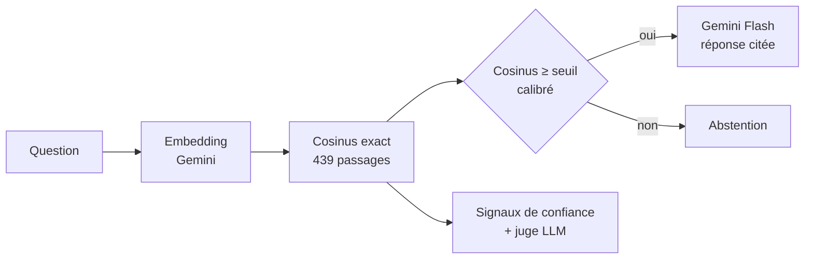

<div align="center">

# Semantica

**Recherche sémantique, RAG et exploration d'embeddings sur le cours INF5101**

TP 1 · Traitement multimédia des données · Module texte · ENSPY

[Démo en ligne](__SPACE_URL__) · [Documentation](docs/) · [API](__SPACE_URL__/api/docs)

</div>

---

Posez une question sur le cours, en français, en anglais ou avec des fautes : Semantica
retrouve la slide qui y répond, génère une réponse courte qui cite ses sources, et sait
dire quand la question sort du périmètre du cours.


## Le sujet

> **Travaux pratiques texte (slide 24)**
> - Importer 50 documents courts ou extraits de cours.
> - Créer des embeddings avec un modèle sentence-transformer ou une API locale/serveur.
> - Construire un petit moteur de recherche sémantique en Python.
> - Tester des questions et analyser les erreurs de récupération.

## Ce qui a été construit

| Énoncé | Réalisation |
| --- | --- |
| 50 documents | **111 documents, 439 passages** : les 60 slides du cours + 51 articles Wikipédia FR du domaine |
| Embeddings sentence-transformer | **3 modèles comparés** (MiniLM, e5-small, Gemini Embedding 2), le meilleur retenu par la mesure |
| Moteur de recherche | **Recherche dense** avec **abstention calibrée** ; hybride BM25 (RRF), routage par langue et reranking évalués puis écartés |
| Tester des questions | **65 questions annotées** en 7 catégories, 7 configurations, Succès@k, MRR, nDCG |
| Analyser les erreurs | Analyse par catégorie et par question, **erreurs visualisées sur la carte des embeddings**, et **analyse de chaque recherche** (signaux de confiance + juge LLM) |

Et au-delà du sujet :

- **Réponse générée (RAG)** en streaming, avec citations cliquables vers les slides.
- **Carte sémantique** interactive : le corpus projeté par UMAP, la question qui « atterrit »
  parmi ses voisins, les passages attendus surlignés quand on vient de l'évaluation.
- **Recherche cross-lingue** : une question en anglais retrouve les slides françaises.
- **Cémantix du cours** : deviner un mot secret par proximité sémantique.
- **Mode révision** : un QCM généré à partir d'une slide, avec renvoi vers la source.

## Résultats

Évaluation sur 65 questions annotées (57 du domaine, 8 hors domaine) :

| Configuration | Succès@1 | Succès@5 | MRR@10 | nDCG@10 |
| --- | --- | --- | --- | --- |
| BM25 (lexical) | 0,54 | 0,79 | 0,65 | 0,54 |
| Dense MiniLM-L12 | 0,63 | 0,77 | 0,68 | 0,56 |
| Dense e5-small | 0,72 | 0,88 | 0,79 | 0,68 |
| **Dense Gemini Embedding 2 (production)** | **0,95** | **1,00** | **0,97** | **0,91** |
| Hybride RRF (BM25 + Gemini) | 0,77 | 0,95 | 0,85 | 0,77 |
| Hybride + reranking bge | 0,81 | 0,93 | 0,85 | 0,74 |

Ce que les erreurs montrent :

- **Le modèle d'embedding fait presque tout** : de 0,72 (e5-small) à 0,95 (Gemini) en Succès@1,
  un écart qu'aucun réglage de pipeline n'a approché.
- **Avec un bon modèle dense, l'hybride et le reranking dégradent** : BM25 fait reculer la
  bonne réponse sur 13 questions et n'en améliore que 3. L'hybride compense un dense faible
  (+2 points avec e5) ; face à Gemini, il dilue le classement. La production garde le dense seul.
- **Paraphrases** : 0,81 en Succès@1 pour Gemini, contre 0,44 pour BM25 et 0,31 pour e5 ; la
  slide en jargon anglais (*tracking*) qu'aucun autre modèle ne trouvait est au rang 1.
- **Abstention** : 8 questions hors domaine sur 8 refusées, aucun refus à tort, 100 % en
  validation croisée (contre 93 % avec e5, dont les scores se chevauchaient).

Le détail, les distributions de scores et l'analyse question par question sont dans
[docs/evaluation.md](docs/evaluation.md) et sur la page *Évaluation* de l'application.

## Architecture



| Couche | Technologies |
| --- | --- |
| Ingestion | PyMuPDF, API Wikipédia, découpage par phrases |
| Recherche | `gemini-embedding-2` (API Gemini) ; en comparaison : bm25s + Snowball FR, e5, MiniLM, `bge-reranker-v2-m3` (Hugging Face) |
| Génération et juge | Gemini Flash (streaming SSE, sorties JSON validées) |
| Visualisation | UMAP, k-means, c-TF-IDF |
| API | FastAPI, Pydantic |
| Interface | React 19, TypeScript, Vite, Tailwind CSS 4, TanStack Query, d3-zoom |
| Déploiement | Docker sur Hugging Face Spaces, CI GitHub Actions |

## Démarrage rapide

```bash
cd backend && uv sync && cp .env.example .env && uv run semantica serve   # renseigner les clés dans .env
cd frontend && pnpm install && pnpm dev     # http://localhost:5173
```

Le corpus et l'index sont versionnés, l'application démarre sans étape de construction.
Voir [docs/developpement.md](docs/developpement.md) pour reconstruire l'index, lancer
l'évaluation et déployer.

## Documentation

| Document | Contenu |
| --- | --- |
| [Méthodologie](docs/methodologie.md) | Corpus, nettoyage, représentations, recherche, RAG, carte, jeu |
| [Évaluation](docs/evaluation.md) | Protocole, résultats, analyse des erreurs, limites |
| [Architecture](docs/architecture.md) | Composants, flux de données, points d'API |
| [Développement](docs/developpement.md) | Installation, reconstruction de l'index, qualité, déploiement |

## Structure

```
backend/     API FastAPI, pipeline d'ingestion, moteur, évaluation (package `semantica`)
  data/      corpus, index, miniatures des slides, jeu d'évaluation et rapport
frontend/    application React
docs/        documentation du projet
scripts/     déploiement sur Hugging Face Spaces
```

## Crédits

- Cours INF5101 *Traitement multimédia des données*, Dr. Aurelle Tchagna, ENSPY.
- Extraits d'articles de [Wikipédia](https://fr.wikipedia.org), sous licence
  [CC BY-SA 4.0](https://creativecommons.org/licenses/by-sa/4.0/deed.fr) ; chaque passage
  renvoie à son article.
- Modèles : [Gemini Embedding 2](https://ai.google.dev/gemini-api/docs/embeddings),
  [bge-reranker-v2-m3](https://huggingface.co/BAAI/bge-reranker-v2-m3),
  [multilingual-e5](https://huggingface.co/intfloat/multilingual-e5-small),
  [paraphrase-multilingual-MiniLM](https://huggingface.co/sentence-transformers/paraphrase-multilingual-MiniLM-L12-v2).

Code sous licence MIT.
