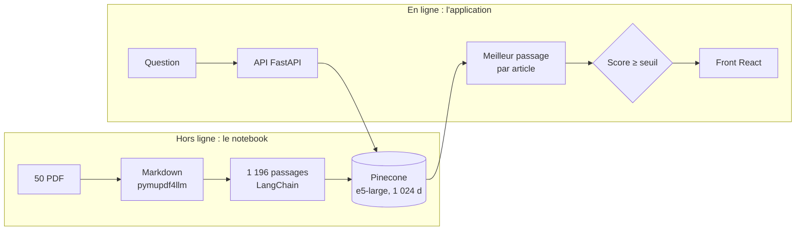

<div align="center">

# Semantica · Articles

**Quels articles lire ? Un moteur de recherche sémantique sur 50 articles scientifiques courts**

TP 1 · Traitement multimédia des données (INF5101) · Module texte · ENSPY

[Application en ligne](__SPACE_URL__) · [Notebook](notebooks/recherche_semantique.ipynb) · [Documentation](docs/)

</div>

---

Un étudiant pose une question, en français ou en anglais ; le moteur lui indique quels articles
lire parmi 50 articles scientifiques sur le texte, l'image, l'audio et le multimodal, avec le
passage qui justifie chaque résultat. Une question française trouve un article anglais, et le
moteur prévient quand aucun article ne traite le sujet.

## Le sujet

> **Travaux pratiques texte (slide 24)**
> - Importer 50 documents courts ou extraits de cours.
> - Créer des embeddings avec un modèle sentence-transformer ou une API locale/serveur.
> - Construire un petit moteur de recherche sémantique en Python.
> - Tester des questions et analyser les erreurs de récupération.

## La démarche, dans un notebook

Tout le travail est déroulé pas à pas dans
[`notebooks/recherche_semantique.ipynb`](notebooks/recherche_semantique.ipynb), exécuté et versionné
avec ses sorties. Principe : des bibliothèques standard partout, du code maison seulement là où le
corpus l'exige.

| Section | Étape | Avec quoi | Fait à la main, et pourquoi |
| --- | --- | --- | --- |
| 1 | Corpus | arXiv, HAL, `httpx`, `pymupdf` | Sélection des 50 articles parmi 226 candidats ([méthode](docs/corpus.md)) |
| 2 | PDF vers Markdown | `pymupdf4llm` | Retirer la page de garde HAL et les références |
| 3 | Découpage | LangChain `MarkdownHeaderTextSplitter` + `RecursiveCharacterTextSplitter` | Préfixer chaque passage par « titre › section » ; écarter les passages vides |
| 4 | Embeddings et index | `multilingual-e5-large` et Pinecone serverless | — |
| 5 | Recherche | `PineconeVectorStore` | Remonter des passages aux articles |
| 6 | Évaluation | `ranx`, `bm25s` | 40 questions annotées |
| 7 | Analyse des erreurs | pandas, matplotlib | Causes des erreurs, biais de langue, seuil d'abstention |
| 8 | Export pour l'application | — | — |

## Résultats

32 questions annotées avec une réponse (factuelles, paraphrases, cross-lingues) et 8 hors corpus.

| Moteur | Hit@1 | Hit@5 | MRR@10 | nDCG@10 |
| --- | --- | --- | --- | --- |
| BM25 (lexical, mêmes passages) | 0,69 | 0,78 | 0,73 | 0,75 |
| **Pinecone + multilingual-e5-large** | **0,94** | **1,00** | **0,95** | **0,96** |

- **L'écart est significatif** sur les quatre métriques (test de Student apparié, p < 0,05). Il
  vient des paraphrases (Hit@1 de 0,70 à 1,00) et surtout du cross-lingue (de 0,30 à 0,80) :
  sur les questions qui reprennent le vocabulaire des articles, les deux moteurs font jeu égal.
- **Biais de langue.** Le corpus compte 30 % d'articles français, mais 73 % des cinq premiers
  résultats d'une question française sont français, contre 12 % pour une question anglaise. Les
  deux erreurs restantes viennent de là : un article français voisin passe devant le bon article
  anglais.
- **Une erreur d'extraction trouvée par l'analyse.** Des passages réduits à un numéro de page
  remontaient sur des questions sans rapport, leur embedding se résumant au titre de l'article.
  Les écarter a corrigé une question sans rien dégrader.
- **Abstention.** Au seuil de 0,838, les 8 questions hors corpus sont refusées et une seule
  question avec réponse l'est à tort ; l'écart entre les deux groupes ne tient qu'à quelques
  millièmes, ce seuil est donc fragile.

Détail et limites : [docs/evaluation.md](docs/evaluation.md).

## Architecture



| Couche | Technologies |
| --- | --- |
| Notebook | pymupdf4llm, LangChain, Pinecone, ranx, bm25s, pandas |
| API | FastAPI, langchain-pinecone, Pydantic |
| Interface | React 19, TypeScript, Vite, Tailwind CSS 4, TanStack Query |
| Déploiement | Vercel (fonction Python et CDN), CI GitHub Actions |

## Démarrage rapide

```bash
# Clé Pinecone dans .env à la racine : PINECONE_API_KEY=...
uv sync && uv run --with jupyterlab jupyter lab      # le notebook
cd app/api && uv sync && uv run uvicorn moteur.main:build --factory   # l'API, port 8000
cd app/web && pnpm install && pnpm dev                # le front, http://localhost:5173
```

Voir [docs/developpement.md](docs/developpement.md) pour reconstruire l'index et déployer.

## Documentation

| Document | Contenu |
| --- | --- |
| [Corpus](docs/corpus.md) | Collecte des candidats, critères de sélection, limites |
| [Méthodologie](docs/methodologie.md) | Extraction, découpage, embeddings, recherche, abstention |
| [Évaluation](docs/evaluation.md) | Protocole, résultats, analyse des erreurs, limites |
| [Architecture](docs/architecture.md) | Notebook, API, front, flux de données |
| [Développement](docs/developpement.md) | Installation, qualité, reconstruction, déploiement |

## Structure

```
notebooks/   le notebook, de la sélection du corpus à l'analyse des erreurs
data/        sélection du corpus, métadonnées, questions d'évaluation (PDF et Markdown non versionnés)
app/api/     API FastAPI (package `moteur`) et données exportées par le notebook
app/web/     application React
docs/        documentation
scripts/     collecte des candidats
legacy-app/  première version (recherche sur les slides du cours), archivée
```

## Crédits

- Cours INF5101 *Traitement multimédia des données*, ENSPY.
- Articles en accès libre sur [arXiv](https://arxiv.org) et [HAL](https://hal.science). Ni les
  PDF ni leur texte ne sont redistribués : le notebook les retélécharge, l'application renvoie
  vers chaque article chez son éditeur.
- Modèle d'embedding : [multilingual-e5-large](https://huggingface.co/intfloat/multilingual-e5-large),
  servi par [Pinecone Inference](https://docs.pinecone.io/guides/inference/understanding-inference).

Code sous licence MIT.
