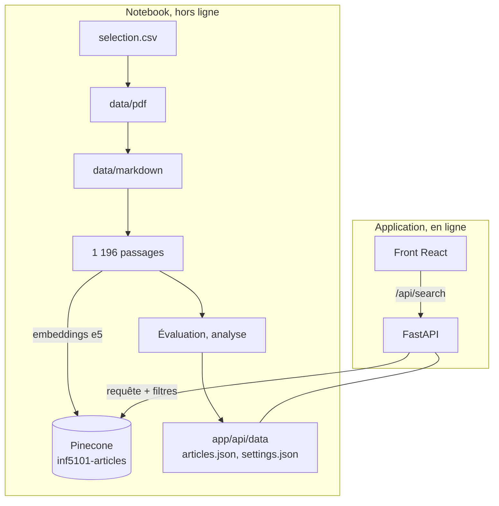

# Architecture

Le projet sépare le travail **hors ligne**, fait une fois dans le notebook, du service **en
ligne**, qui ne fait que l'exploiter.

## Le notebook, source de vérité

Il construit l'index Pinecone et exporte (section 8) ce dont l'application a besoin :

- `articles.json` : la fiche des 50 articles (titre, langue, modalité, année, pages, URL, résumé) ;
- `settings.json` : nom de l'index, modèle, nombre de passages récupérés, seuil d'abstention et
  résultats de l'évaluation, affichés dans la page À propos.

Si le corpus, le découpage ou le modèle changent, on réexécute le notebook : l'index et les
réglages de l'application suivent.

## L'API (`app/api`, package `moteur`)

| Module | Rôle |
| --- | --- |
| `catalog.py` | Charge et valide `articles.json` et `settings.json` (Pydantic) |
| `search.py` | Interroge Pinecone, regroupe les passages par article, nettoie le Markdown pour l'affichage |
| `ratelimit.py` | Limite chaque visiteur à 20 recherches par minute, pour protéger le quota gratuit |
| `main.py` | Routes, et service du front compilé en production |

| Route | Réponse |
| --- | --- |
| `GET /api/search?q=…&langue=fr&modalite=audio&k=5` | Articles classés, meilleur passage de chacun, score, seuil, abstention |
| `GET /api/articles` | Les 50 fiches |
| `GET /api/stats` | Réglages et résultats d'évaluation |
| `GET /api/docs` | Documentation OpenAPI |

Les filtres de langue et de modalité sont des filtres de métadonnées Pinecone, appliqués avant le
classement. Une erreur de Pinecone (réseau, quota, clé) est capturée à la frontière et renvoyée en
résultat typé (`SearchFailure`), que la route traduit en 503.

## Le front (`app/web`)

React 19, TypeScript, Vite, Tailwind CSS 4 et TanStack Query, avec la charte « bureau papier »
reprise de l'application précédente. Trois pages :

- **Recherche** : la question et les filtres vivent dans l'URL, une recherche est donc partageable ;
- **Corpus** : les 50 articles, filtrables par langue, modalité et titre ;
- **À propos** : la chaîne de traitement, les résultats de l'évaluation et les choix techniques.

## Déploiement

Une seule image Docker (voir [developpement.md](developpement.md)) : le front est compilé dans une
première étape, puis servi par FastAPI à côté de l'API. L'image ne contient ni torch ni modèle :
les embeddings des questions sont calculés par Pinecone.
