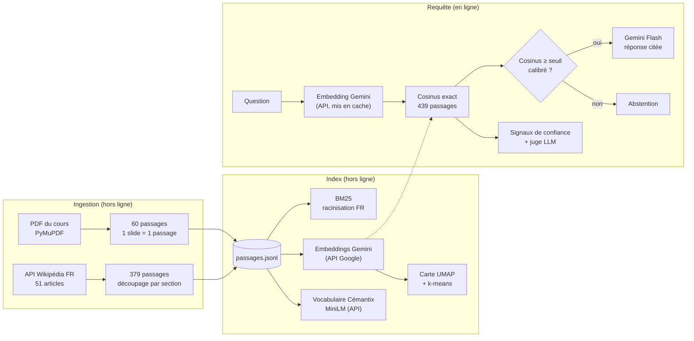

# Architecture

## Vue d'ensemble



## Découpage du code

```
backend/src/semantica/
├── corpus.py            Modèle Passage, lecture/écriture JSONL
├── text.py              Tokenisation FR, racinisation Snowball, détection de langue
├── ingest/              Slides (PyMuPDF), Wikipédia (API + cache), découpage
├── inference.py         Client Inference Providers (embeddings, reranking), erreurs typées
├── retrieval/           BM25, dense, fusion RRF, reranking, moteur avec repli
├── semantic_map.py      UMAP + clusters k-means étiquetés par c-TF-IDF
├── cemantix.py          Jeu : vocabulaire, voisinages, température
├── llm.py               Client Gemini (streaming SSE, JSON, repli de modèle), erreurs typées
├── judge.py             Juge LLM de chaque recherche
├── diagnostics.py       Signaux de confiance de chaque recherche
├── rag.py / quiz.py     Prompts de génération
├── evaluation/          Métriques, campagne, calibration de l'abstention
├── indexing.py          Construction de tous les artefacts
├── api/                 FastAPI : routes, schémas, limitation de débit
└── cli.py               semantica ingest | build | evaluate | serve

frontend/src/
├── api/                 Client typé, lecteur SSE
├── pages/               Recherche, Comparer, Carte, Évaluation, Cémantix, Révision, À propos
└── components/          Cartes de résultat, réponse générée, visionneuse de slides
```

## Principes

**Hors ligne / en ligne.** Tout ce qui est coûteux (embeddings du corpus, UMAP, BM25,
vocabulaire du jeu, calibration) est calculé une fois par `semantica build` et
`semantica evaluate`, puis versionné dans `backend/data/index/`. Le serveur ne fait que
charger des fichiers : le déploiement sert exactement l'index qui a été évalué.

**Erreurs aux frontières.** Les appels réseau (Wikipédia, Gemini, Hugging Face) ne lèvent jamais
d'exception vers le cœur : ils renvoient un résultat typé (`FetchFailure`,
`InferenceError`, `LlmError`)
que l'appelant traite explicitement. Une panne de la génération n'empêche pas la recherche
de fonctionner ; une panne des embeddings fait replier le moteur sur BM25, et la réponse le
signale (`degraded`).

**Un seul déploiement.** FastAPI sert l'API sous `/api`, les miniatures de slides sous
`/slides` et le front compilé pour tout le reste (avec repli sur `index.html` pour le
routage côté client).

## Points d'API

| Méthode | Route | Rôle |
| --- | --- | --- |
| `POST` | `/api/search` | Recherche (production : `dense` ; aussi `bm25`, `hybrid`, `hybrid_rerank`) |
| `POST` | `/api/diagnose` | Signaux de confiance d'une recherche |
| `POST` | `/api/judge` | Juge LLM : verdict par passage, précision estimée, diagnostic |
| `POST` | `/api/compare` | Les quatre méthodes sur la même question |
| `POST` | `/api/ask` | RAG en flux SSE : `sources`, `token`…, `abstain` ou `error`, `done` |
| `GET` | `/api/map` | Points UMAP et clusters |
| `POST` | `/api/map/project` | Projection d'une question et ses voisins cosinus |
| `GET` | `/api/evaluation` | Rapport d'évaluation complet |
| `POST` | `/api/quiz` | QCM généré depuis une slide |
| `*` | `/api/cemantix/*` | Jeu : partie du jour, essai, indice, abandon |
| `GET` | `/api/stats` | Corpus, modèles, calibration |

La documentation OpenAPI interactive est servie sur `/api/docs`.
